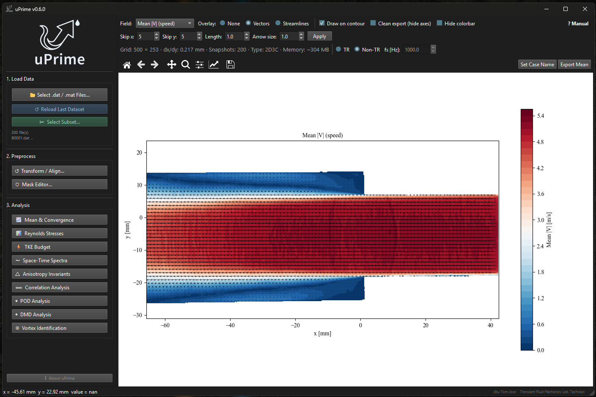

# uPrime

+++ {"kind": "centered"}
:::{image} user_guide/logo.png
:width: 10%
:alt: uPrime logo
:class: dark:hidden
:::

:::{image} user_guide/logo_upblue.png
:width: 10%
:alt: uPrime logo
:class: hidden dark:block
:::

_Turbulence is complex. Analysis shouldn\'t be._

+++

[uPrime](https://cmdrryder.github.io/uPrime/) [@jose2026uprime] is a standalone desktop application for post-processing and
turbulence analysis of velocity field data from PIV and CFD. Reads
Tecplot ASCII .dat (LaVision DaVis) and MATLAB .mat files. 

_No scripting.  No setup. Just analysis._

{button}`Download v0.6.1 <https://github.com/CmdrRyder/uPrime/releases/latest>`
{button}`View on GitHub <https://github.com/CmdrRyder/uPrime>`
{button}`DOI <https://doi.org/10.5281/zenodo.19376184>`
{button}`Manual (PDF) <https://github.com/CmdrRyder/uPrime/tree/main/docs/Manual.pdf>`

:::{note} NEW IN v0.6

- **Mean & Convergence module**: mean velocity line profiles plus
  point-wise statistical convergence check using Welford\'s online
  algorithm with sustained-crossing N\* detection.
- **MATLAB .mat file input**: classic v5/v7 and v7.3 (HDF5). Variable
  confirmation dialog with auto-detection, snapshot subset spinboxes,
  single-snapshot rejection.
- **Multi-case comparison**: import previous results as CSV and overlay
  in Reynolds stress, TKE budget, spectra, correlation, anisotropy, and
  mean velocity plots.
- **Inline non-convergence notice**: persistent amber top-bar on
  Reynolds, TKE, and Spectra modules when fewer than 500 snapshots are
  loaded.
- **TKE budget split panels**: TKE k now plotted in a dedicated upper
  panel, P/C/D/R in the lower panel sharing the x-axis.
- **Float16 storage option** for .mat files exceeding 5 GB, with
  explicit warning about reduced numerical precision.
:::

## Key Features

:::::::::::::::{grid}
:::{card}
### 📊 Convergence verification

Cumulative first, second, and third central moments at any picked point,
with automatic N\* detection. Know whether your statistics are
trustworthy before you publish them.
:::

:::{card}
### 📂 Two input formats

Reads Tecplot ASCII .dat from DaVis (one file per snapshot) and MATLAB
.mat files (full time series in a single file, classic and v7.3 HDF5).
Auto-detects variable names.
:::

:::{card}
### ⚡ Non-blocking computation

All heavy analysis runs in background threads. The window stays fully
responsive during POD, DMD, TKE budget, and vortex identification.
:::

:::{card}
### 💾 Large dataset support

Datasets exceeding 4 GB are automatically memory-mapped to disk. Handle
10,000+ snapshots without running out of RAM.
:::

:::{card}
### 🎭 Non-destructive masking

Draw masks over walls, shadows, and reflections. Raw data is never
modified. Toggle masks on and off instantly.
:::

:::{card}
### 🔍 Unit auto-detection

Reads mm/m/s units directly from Tecplot .dat file headers and MATLAB
variable shapes. No manual configuration needed.
:::

:::{card}
### 📄 Publication-ready export

PNG (300 DPI), PDF, and SVG with editable text. Compatible with Adobe
Illustrator and Inkscape.
:::

:::{card}
### 🖥️ Standalone executable

Windows .exe with no Python or dependencies required. macOS and Linux
users run from source in three commands.
:::

:::{card}
### 📐 Transform & Alignment

Correct camera misalignment, shift the coordinate origin, and mirror
datasets. Built for experimental data where even a 1° tilt can corrupt
turbulence statistics.
:::

:::{card}
### 🧠 Full turbulence pipeline

Reynolds stresses, TKE budget, spectra, POD, DMD, correlations, and
vortex identification, all in one environment. No MATLAB or Python
required.
:::

:::{card}
### 📏 Integral scales & correlation

Compute spatial and temporal correlations with automatic integral length
and time scale extraction using multiple robust methods.
:::

:::{card}
### 🔀 Multi-case comparison

Import previous results as CSV and overlay them on top of the current
dataset. Per-case styling, manage cases, combined export.
:::
:::::::::::::::

:::{note} Input Formats

**Tecplot ASCII `.dat`** (LaVision DaVis export): one file per snapshot,
select multiple files to load a time series. Variable names and units
auto-detected from the header. Supports 2D2C and 2D3C (stereo).

**MATLAB `.mat`** (classic v5/v7 and v7.3 HDF5): a single file
containing the entire dataset. Velocity arrays in shape
`(Ny, Nx, N_snap)`; coordinates as 1D vectors or 2D meshgrid
(auto-transposed if needed). Variable confirmation dialog reads metadata
first, so even a 10+ GB file opens the dialog within seconds.
:::

## Analysis Modules

::::::::::::::{grid}
:::{card .attention}
{span .text-red-500}`✓ `Mean & Convergence [v0.6]
:::

:::{card}
{span .text-green-500}`✓ `Reynolds Stress Analysis
:::

:::{card}
{span .text-green-500}`✓ `TKE Budget
:::

:::{card}
{span .text-green-500}`✓ `Space-Time Spectral Analysis
:::

:::{card}
{span .text-green-500}`✓ `Anisotropy Invariants [Stereo only]
:::

:::{card}
{span .text-green-500}`✓ `Correlation Analysis
:::

:::{card}
{span .text-green-500}`✓ `POD Analysis
:::

:::{card}
{span .text-green-500}`✓ `DMD Analysis [TR only]
:::

:::{card}
{span .text-green-500}`✓ `Vortex Identification
:::

:::{card}
{span .text-green-500}`✓ `Mask Editor
:::

:::{card}
{span .text-green-500}`✓ `Coordinate Transform
:::
::::::::::::::

+++ {"kind": "centered"}

Developed by **Jibu Tom Jose** · [Transient Fluid Mechanics Laboratory](https://www.tfmltechnion.com/), Technion

Built with assistance from
[Claude](https://www.anthropic.com) (Anthropic)

[GitHub](https://github.com/CmdrRyder/uPrime) ·
[Releases](https://github.com/CmdrRyder/uPrime/releases) ·
[Zenodo](https://doi.org/10.5281/zenodo.19376184) ·
[GPLv3](https://www.gnu.org/licenses/gpl-3.0.en.html)

These are derived quantities, not conclusions. Interpret with care.

+++
