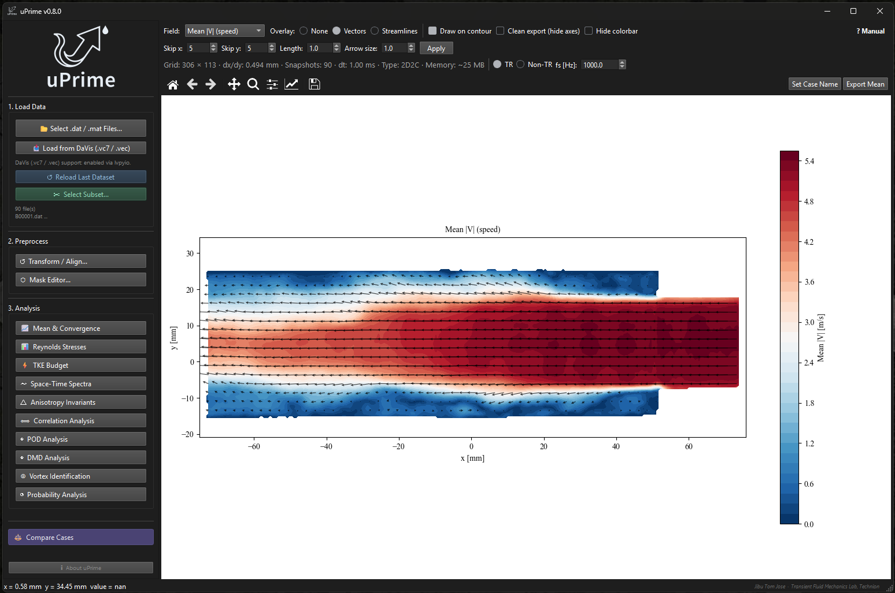

# uPrime

+++ {"kind": "centered"}
:::{image} user_guide/logo.png
:width: 10%
:alt: uPrime logo
:class: dark:hidden
:::

:::{image} user_guide/logo_upblue.png
:width: 10%
:alt: uPrime logo
:class: hidden dark:block
:::

_Turbulence is complex. Analysis shouldn\'t be._

+++

[uPrime](https://cmdrryder.github.io/uPrime/) [@jose2026uprime] is a standalone desktop application for post-processing and
turbulence analysis of velocity field data from PIV and CFD. Reads
Tecplot ASCII .dat (LaVision DaVis) and MATLAB .mat files. 

_No scripting.  No setup. Just analysis._

{button}`Download v0.9.2 <https://github.com/CmdrRyder/uPrime/releases/latest>`
{button}`View on GitHub <https://github.com/CmdrRyder/uPrime>`
{button}`DOI <https://doi.org/10.5281/zenodo.19376184>`
{button}`Manual (PDF) <https://github.com/CmdrRyder/uPrime/tree/main/docs/Manual.pdf>`

Python users: `pip install uprime-piv` → run with: `uprime`

:::{note} NEW IN v0.9.0

- **Installable with pip**: `pip install uprime-piv` (on PyPI since v0.9.1)
  gives you a `uprime` command and an importable `uprime` package. The
  package name and the command differ: you install `uprime-piv` and run
  `uprime`.
- **Corrected invalid-vector handling**: a vector marked invalid is now
  excluded in every snapshot it is invalid in, not just the first.
  **Statistics produced from `.dat` data by v0.4.1–v0.8.2 should be
  recomputed.**
- **Documented Python API**: `docs/API.md` describes every public function
  in `uprime.core`, with a worked example in `examples/`, so the analysis
  can be scripted as well as clicked.
- **Consistent grid orientation**: `.dat`, `.vc7` and `.mat` now share one
  convention — row 0 at the smallest y, column 0 at the smallest x — so
  cases from different sources are directly comparable.
- **Tested on Windows, macOS and Linux**: the suite runs in CI on all three
  across Python 3.10 and 3.12.
:::

:::{note} NEW IN v0.8

- **Probability Analysis module**: a new window with four tabs covering
  velocity probability, flow direction, binary space-time maps, and
  quadrant analysis.
- **PDF tab**: probability density of `u`, `v`, `w`, `|V|` or their
  fluctuations, sampled at a point, along a line, inside a dragged ROI, or
  over the whole field, with an optional matched Gaussian overlay and a
  mean/std/skewness/kurtosis readout.
- **Flow Direction tab**: per-point forward and reverse flow probability
  maps, with an explicit FFP `P(q > 0)` versus RFP `P(q < 0)` convention
  carried through the title, colorbar and every export, plus optional
  Simpson detachment-state contours.
- **Binary Space-Time tab**: the classic space-versus-time map coloured by
  flow direction along a horizontal or vertical line, with band averaging
  and normalised axes. Time-resolved data only.
- **Quadrant tab**: Lu & Willmarth quadrant decomposition of a fluctuation
  pair, with time- and stress-fraction maps, a joint PDF with the hole
  hyperbola, Q2/Q4 stress maps, and a hole-size sweep.
- **ROI restricts computation**: a dragged ROI limits what is read and
  computed rather than only what is displayed, so a small ROI on a large
  dataset is correspondingly cheaper. Regions outside the ROI render in a
  distinct grey.
- **Compare Cases viewer** (v0.7): standalone window comparing up to six
  datasets at once, with a 1D overlay plus value table and a 2D Field
  Compare tiled contour view sharing one color scale.
- **DaVis native input** (v0.7): read LaVision DaVis `.vc7` and `.vec`
  files directly when the optional **lvpyio** package is installed
  separately (`pip install lvpyio`). Not bundled in the Windows executable;
  available when running uPrime from source.
:::

## Key Features

:::::::::::::::{grid}
:::{card}
### 📊 Convergence verification

Cumulative first, second, and third central moments at any picked point,
with automatic N\* detection. Know whether your statistics are
trustworthy before you publish them.
:::

:::{card}
### 📂 Two input formats

Reads Tecplot ASCII .dat from DaVis (one file per snapshot) and MATLAB
.mat files (full time series in a single file, classic and v7.3 HDF5).
Auto-detects variable names.
:::

:::{card}
### ⚡ Non-blocking computation

All heavy analysis runs in background threads. The window stays fully
responsive during POD, DMD, TKE budget, and vortex identification.
:::

:::{card}
### 💾 Large dataset support

Datasets exceeding 4 GB are automatically memory-mapped to disk. Handle
10,000+ snapshots without running out of RAM.
:::

:::{card}
### 🎭 Non-destructive masking

Draw masks over walls, shadows, and reflections. Raw data is never
modified. Toggle masks on and off instantly.
:::

:::{card}
### 🔍 Unit auto-detection

Reads mm/m/s units directly from Tecplot .dat file headers and MATLAB
variable shapes. No manual configuration needed.
:::

:::{card}
### 📄 Publication-ready export

PNG (300 DPI), PDF, and SVG with editable text. Compatible with Adobe
Illustrator and Inkscape.
:::

:::{card}
### 🖥️ Standalone executable

Windows .exe with no Python or dependencies required. macOS and Linux
users run from source in three commands.
:::

:::{card}
### 📐 Transform & Alignment

Correct camera misalignment, shift the coordinate origin, and mirror
datasets. Built for experimental data where even a 1° tilt can corrupt
turbulence statistics.
:::

:::{card}
### 🧠 Full turbulence pipeline

Reynolds stresses, TKE budget, spectra, POD, DMD, correlations, and
vortex identification, all in one environment. No MATLAB or Python
required.
:::

:::{card}
### 📏 Integral scales & correlation

Compute spatial and temporal correlations with automatic integral length
and time scale extraction using multiple robust methods.
:::

:::{card}
### 🔀 Multi-case comparison

Import previous results as CSV and overlay them on top of the current
dataset. Per-case styling, manage cases, combined export.
:::
:::::::::::::::

:::{note} Input Formats

**Tecplot ASCII `.dat`** (LaVision DaVis export): one file per snapshot,
select multiple files to load a time series. Variable names and units
auto-detected from the header. Supports 2D2C and 2D3C (stereo).

**MATLAB `.mat`** (classic v5/v7 and v7.3 HDF5): a single file
containing the entire dataset. Velocity arrays in shape
`(Ny, Nx, N_snap)`; coordinates as 1D vectors or 2D meshgrid
(auto-transposed if needed). Variable confirmation dialog reads metadata
first, so even a 10+ GB file opens the dialog within seconds.

**LaVision DaVis `.vc7` / `.vec`** (optional): read DaVis vector files
natively when the **lvpyio** package is installed separately
(`pip install lvpyio`). lvpyio is not bundled in the Windows executable,
so this input is available when running uPrime from source; once
installed, `.vc7`/`.vec` files load through the same workflow as `.dat`
and `.mat`.
:::

## Analysis Modules

::::::::::::::{grid}
:::{card}
{span .text-green-500}`✓ `Mean & Convergence
:::

:::{card}
{span .text-green-500}`✓ `Compare Cases
:::

:::{card}
{span .text-green-500}`✓ `Reynolds Stress Analysis
:::

:::{card}
{span .text-green-500}`✓ `TKE Budget
:::

:::{card}
{span .text-green-500}`✓ `Space-Time Spectral Analysis
:::

:::{card}
{span .text-green-500}`✓ `Anisotropy Invariants [Stereo only]
:::

:::{card}
{span .text-green-500}`✓ `Correlation Analysis
:::

:::{card}
{span .text-green-500}`✓ `POD Analysis
:::

:::{card}
{span .text-green-500}`✓ `DMD Analysis [TR only]
:::

:::{card}
{span .text-green-500}`✓ `Vortex Identification
:::

:::{card .attention}
{span .text-red-500}`✓ `Probability Analysis [v0.8]
:::

:::{card}
{span .text-green-500}`✓ `Mask Editor
:::

:::{card}
{span .text-green-500}`✓ `Coordinate Transform
:::
::::::::::::::

+++ {"kind": "centered"}

Developed by **Jibu Tom Jose** · [Transient Fluid Mechanics Laboratory](https://www.tfmltechnion.com/), Technion

Built with assistance from
[Claude](https://www.anthropic.com) (Anthropic)

[GitHub](https://github.com/CmdrRyder/uPrime) ·
[Releases](https://github.com/CmdrRyder/uPrime/releases) ·
[Zenodo](https://doi.org/10.5281/zenodo.19376184) ·
[GPLv3](https://www.gnu.org/licenses/gpl-3.0.en.html)

These are derived quantities, not conclusions. Interpret with care.

+++
