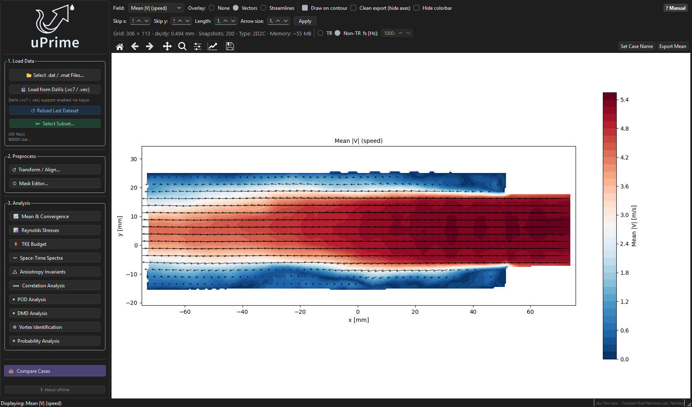

# Summary

Particle image velocimetry (PIV) measures the velocity of a flowing fluid over a plane, typically producing thousands of snapshots of a two- or three-component velocity field. Numerical simulations (CFD) produce data of the same form. Turning these snapshots into physical understanding requires turbulence statistics: the mean flow, Reynolds stresses, the turbulent kinetic energy (TKE) budget, spectra, correlations, and modal decompositions that extract coherent structures.

uPrime is an open-source desktop application that performs these analyses through a graphical interface, without programming. A user loads a sequence of velocity fields, corrects the alignment of the measurement plane, masks walls or reflections, and opens analysis modules for mean flow and statistical convergence, Reynolds stresses, the TKE budget, spectra, anisotropy invariants, two-point correlations, proper orthogonal decomposition (POD), dynamic mode decomposition (DMD), vortex identification, and probability and quadrant analysis (\autoref{fig:gui}). Results are exported as publication-quality figures and data files, and a comparison viewer overlays up to six cases. The same computations are available as a documented Python package, `uprime.core`, for scripted workflows.

# Statement of need

In a typical experimental study, vector fields are computed with a commercial or open-source PIV package and then analysed with custom scripts. Each group, and often each student, rewrites the same post-processing: averaging with validity masks, finite-difference gradients for the production and transport terms of the TKE budget [@Pope_2000], Welch spectra [@Welch_1967], snapshot POD [@Sirovich_1987], DMD [@Schmid_2010; @Tu_2014], and vortex criteria [@Hunt_1988; @Jeong_1995; @Zhou_1999; @Graftieaux_2001]. These scripts are rarely tested and are hard to share. They also handle invalid vectors and grid orientation inconsistently, so two analyses of the same data can disagree for reasons that have nothing to do with the flow. Students and engineers without a programming background are often limited to the statistics their processing software exports.

uPrime is written for experimentalists, students and engineers who need a standard set of turbulence diagnostics applied consistently to planar (2D2C) and stereoscopic (2D3C) data, and for researchers who want the same tested routines in their own scripts. It reads Tecplot ASCII exports, MATLAB files including large HDF5-based files, and, optionally, LaVision DaVis vector files.

# State of the field

Open-source PIV software concentrates on computing vector fields from images. PIVlab [@Thielicke_2014; @Thielicke_2021] provides a graphical workflow in MATLAB from images to vector fields and derived quantities. OpenPIV [@Ben_Gida_2020] offers open processing in MATLAB and Python, and PIVtools [@Taylor_2026] combines planar, stereoscopic and ensemble correlation with graphical and command-line interfaces. Commercial packages such as LaVision DaVis include post-processing, but they are proprietary and require a licence. For analysis, Python libraries provide individual methods to users who write code: PyDMD [@Demo_2018] and modred [@Belson_2014] for modal decompositions, FluidSF [@Wagner_2025] for structure functions and related turbulence statistics, and PIVPy (<https://pivpy.readthedocs.io>) for reading and manipulating PIV fields.

We did not find an open tool that brings single-point statistics, budgets, spectra, correlations, modal decompositions and structure identification together in one graphical application that works on the vector fields these processors export. Building the analyses into a processing package would tie them to one image-processing pipeline and, for PIVlab, to MATLAB. Contributing them to a scripting library would not serve users who do not program. uPrime therefore complements these tools: it starts where vector processing ends, accepts output from several of them, and builds on established numerical libraries [@Harris_2020; @Virtanen_2020; @Hunter_2007; @Frigo_2005] instead of reimplementing them.

# Software design

**Computation separated from the interface.** All numerical routines live in `uprime.core` as functions on NumPy arrays with a fixed convention: time series are `[ny, nx, Nt]` arrays, coordinates are in millimetres, velocities are in metres per second, and invalid vectors are NaN. The interface, `uprime.gui`, built with PyQt6, only collects parameters, starts computations and plots results. This keeps the numerics testable without a display and lets scripts call exactly the functions the interface uses. The cost is that interactive features must pass state explicitly, which makes the interface code more verbose.

**One data model for every input format.** The Tecplot, MATLAB and DaVis loaders return the same dataset and enforce the same conventions, whatever the order of the data in the file: row 0 holds the smallest y and column 0 the smallest x, an invalid vector is NaN in the snapshot where it occurs, and a grid point is masked only if it is invalid in every snapshot. Masks drawn by the user are stored separately as a two-dimensional boolean array and applied on demand, so they never alter the loaded data. Mean-flow statistics, convergence [@Welford_1962] and probability measures skip missing values. POD, DMD and FFT-based spectra need complete data, so gaps in the fluctuation field are filled with zero, which is the local temporal mean. For POD and DMD, points missing from 10 % or more of the snapshots are excluded, and the fraction of filled values is reported with the result. This makes the effect of data dropout visible instead of hiding it in an interpolation.

**Large datasets and a responsive interface.** Velocity fields are stored as 32-bit floats. Datasets larger than 4 GB are memory-mapped to disk, and the MATLAB loader reads HDF5 files one frame at a time and reorients them with array views to avoid copies. Each long computation runs in its own Qt worker thread, so the interface stays responsive and reports progress.

**Distribution.** Laboratory computers often have no Python environment, and their users may not be able to install one. uPrime is therefore distributed as a standalone Windows executable built with PyInstaller, and as a pip-installable package for Windows, macOS and Linux. Reading DaVis files requires LaVision's separately licensed `lvpyio` package, so this support is optional and is not included in the public executable.

**Testing.** A pytest suite runs in continuous integration on Linux, macOS and Windows. Its tests compare results with synthetic fields whose answers are known, for example the Reynolds stresses and POD energy of a prescribed standing mode, and the DMD frequency of a travelling wave with randomly invalid vectors. Other tests check that every loader produces identical arrays from files written in different orientations and formats.

# Research impact statement

uPrime is used for experimental work at the Transient Fluid Mechanics Laboratory at the Technion. In @Zuckerman_2026, uPrime was used alongside independent MATLAB processing to compute and cross-check the ensemble-averaged mean velocities and Reynolds stresses of separated flow over trapezoidal wall protrusions measured with PIV. **[TODO: add any other studies, theses, courses or external groups that have used uPrime, with specifics.]** The anisotropy module places measured Reynolds stresses on the Lumley triangle and barycentric map [@Lumley_1977; @Banerjee_2007], and the quadrant module follows @Lu_1973, so these established diagnostics can be applied to any PIV or CFD dataset in a few clicks. uPrime has been developed in the open since April 2026, with every release archived on Zenodo.

# AI usage disclosure

Generative AI tools were used in developing uPrime and in preparing this paper. **[TODO: name the tools and model versions, for example Claude Code with specific Claude models, and the period of use. Include the AI-assisted MATLAB code used for the cross-check.]** They were used to implement and refactor code, write tests, and draft documentation. The authors designed the methods and the software architecture, specified the algorithms with reference to the literature cited above, and reviewed all generated code. Correctness was checked with the automated test suite, with comparisons against synthetic fields with known analytical results, and by comparing results on experimental PIV data with an independent MATLAB implementation written separately from uPrime. This paper was drafted with the help of an Anthropic Claude model. All references were checked against publisher records through Crossref, and the authors revised and approved the text.

# Acknowledgements

**[TODO: funding sources and grant numbers, and contributors who are not authors.]**

# References
