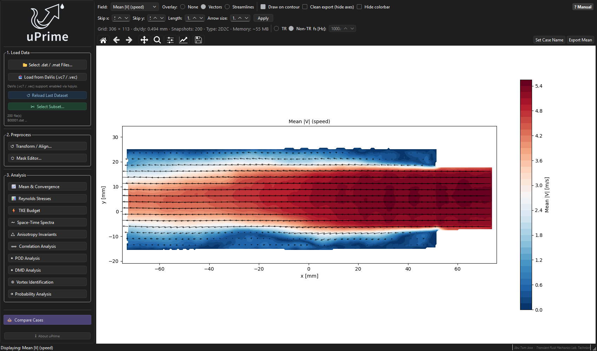

# Summary

uPrime is an open-source desktop application and Python package for analysing velocity fields from particle image velocimetry (PIV) experiments and computational fluid dynamics (CFD) simulations. It provides downstream tools for mean-flow and turbulence statistics, energy budgets, spectra, correlations, modal decompositions, vortex identification, and flow-event statistics. It supports planar two-component and stereoscopic three-component PIV fields, as well as structured CFD data.

A defining feature is the dedicated Compare Cases viewer. It brings uPrime outputs from separate experiments or simulations into one environment, including results from different analysis modules and supported export formats. It groups files by physical quantity, overlays one-dimensional results, and displays up to six two-dimensional fields together. A profile extracted across the fields can also be compared directly between cases. The graphical interface and Python API use the same numerical core [@uPrime_2026].

# Statement of need

Modern PIV and CFD studies produce large sequences of spatially resolved velocity fields. After vector generation, researchers often move between acquisition software, analysis scripts, and specialist packages to calculate turbulence statistics, spectra, correlations, coherent structures, and flow-event statistics. Differences in file conventions, coordinate orientation, masking rules, and invalid-vector treatment can make workflows difficult to reproduce or transfer between data sources.

Comparison across cases is equally important. Researchers routinely compare different geometries, Reynolds numbers, operating conditions, measurement techniques, or simulations. These results may come from separate analyses and be stored in different formats. Bringing them together can require custom scripts to identify corresponding quantities, reconcile file structures, and produce consistent plots.

uPrime addresses both stages. It reads exported velocity fields rather than particle images, accepts data from multiple PIV workflows and structured CFD, and provides a consistent set of preprocessing and diagnostics. Its Compare Cases viewer collects uPrime-generated results from separate cases, identifies and groups physical quantities, and displays comparable results together. The intended users are experimental and computational fluid mechanics researchers, students, and engineers, whether they prefer a graphical interface or scripted analysis. uPrime complements image-correlation software by focusing on downstream analysis and cross-case comparison.

# State of the field

Open-source tools such as PIVlab, OpenPIV, FluidImage, and PIVtools support image-to-velocity workflows. PIVlab provides a graphical environment for PIV processing, vector validation, derived fields, and selected temporal statistics [@Thielicke_2014; @Thielicke_2021]. OpenPIV provides Python implementations and related MATLAB tools [@Ben_Gida_2020; @OpenPIV_2026]. FluidImage is a Python framework for computing flow fields from images [@Augier_2024]. PIVtools combines planar, stereoscopic, and ensemble PIV processing, including Reynolds-stress extraction from ensemble correlations [@Taylor_2026]. Commercial platforms such as LaVision DaVis also provide integrated processing and post-processing, but are proprietary.

Downstream tools include PIVMat, a MATLAB toolbox for importing and analysing two- and three-component vector fields [@Moisy_2026]; PIVPy, a Python workflow for reading and analysing PIV data from different vendors [@PIVPy_2026]; FluidSF for turbulence statistics and structure functions [@Wagner_2025]; and PyDMD and modred for modal decomposition [@Demo_2018; @Belson_2014]. These tools overlap with parts of uPrime's functionality, but each covers a subset of methods and is used through code. uPrime builds on established methods rather than proposing new turbulence algorithms. Its distinguishing contribution is integration: ten analysis modules, from single-point statistics and TKE budgets to spectra, modal decomposition, vortex identification and event statistics, operate on one shared dataset within a single application, and new modules can be added within the same structure. Together with Compare Cases, this lets users analyse and compare datasets without switching between tools or maintaining bespoke scripts.

uPrime was built as a separate application rather than as an extension of an existing package because its analyses operate on already-computed fields from several PIV processors and CFD solvers, independent of any one image-correlation pipeline, and because its users include researchers who prefer a graphical workflow, which the scripting libraries above do not target. It builds on NumPy, SciPy, Matplotlib and FFTW [@Harris_2020; @Virtanen_2020; @Hunter_2007; @Frigo_2005].

# Software design

*Shared numerical core.* Numerical routines are implemented in `uprime.core` independently of Qt. The PyQt6 interface handles file selection, parameters, progress reporting, and visualisation; the Python package exposes the same calculations for scripts. This separation avoids duplicate implementations, enables headless testing, and keeps interactive and batch results consistent.

*Dataset representation and validity.* Each loader returns a dataset dictionary with common core fields, including coordinate grids (`x`, `y`), velocity components (`U`, `V`, and `W` when available), validity and masking information, and source metadata. Time series use `[ny, nx, Nt]` arrays, coordinates are in millimetres, and velocities are in metres per second. Loaders normalise grid orientation so row 0 corresponds to the smallest `y` and column 0 to the smallest `x`. A vector invalid in an individual snapshot is represented by NaN in that snapshot; a separate spatial mask handles points invalid throughout the sequence. The shared masking accessor applies the mask to a copy, preserving the stored arrays and valid measurements at other times. POD and DMD require complete snapshot matrices. Grid points missing in at least 10% of snapshots are excluded, remaining gaps are filled with the point's temporal mean, and the filled fraction is reported.

*Scalability and responsiveness.* Tecplot files larger than 4 GB are memory-mapped, and HDF5-based MATLAB v7.3 files are read one snapshot at a time. Long calculations run in Qt worker threads so the interface remains responsive and can report progress. Manual tests with laboratory data have included datasets of up to 10,000 vector fields (approximately 16 GB) and 3,000 high-resolution fields (approximately 20 GB).

*Case comparison.* Compare Cases is a dedicated viewer for results exported from separate uPrime analyses. It works on analysis outputs and does not require the original velocity fields to be loaded again. It accepts one-dimensional line profiles and spectra saved as CSV or Excel files, and two-dimensional fields saved as Tecplot ASCII. Each one-dimensional export includes a header recording the analysis module and its settings, preserving information about how the result was generated.

When files from different datasets and supported formats are loaded, the viewer identifies their quantities, such as `U`, `TKE`, or `R_uv`, and groups files by quantity. The one-dimensional view overlays profiles, spectra, and trajectories in the Lumley triangle. The two-dimensional view tiles up to six fields, using either a shared colour scale or individual scales. Drawing a line across the fields extracts the corresponding profile from every case and displays the profiles in the one-dimensional view. Comparisons can be exported as figures or as a merged CSV file.

*Methods, testing, and distribution.* The analysis modules implement established methods, including Welford's online convergence statistics [@Welford_1962], Welch spectral estimation [@Welch_1967], snapshot POD and DMD [@Sirovich_1987; @Schmid_2010; @Tu_2014], vortex-identification criteria [@Hunt_1988; @Jeong_1995; @Zhou_1999; @Graftieaux_2001], turbulence anisotropy invariants [@Lumley_1977; @Banerjee_2007], quadrant analysis [@Lu_1973], and standard TKE-budget terms [@Pope_2000].

An automated `pytest` suite runs in continuous integration on Windows, macOS, and Linux. The v0.9.2 suite includes 68 tests. Synthetic fields with known analytical properties test Reynolds stresses, POD energy, and DMD frequencies. Further tests cover loader consistency across formats and grid orientations, invalid-vector handling, and GUI smoke tests. The public sample dataset [@uPrime_data_2026] contains 100 snapshots of stereoscopic 2D3C data and 200 snapshots of time-resolved planar 2D2C data.

The `uprime-piv` package supports Python 3.10 and later on Windows, macOS, and Linux. Users install it from PyPI and launch the interface with `uprime`; numerical routines are available through `uprime.core`. Native DaVis `.vc7` and `.vec` input is optional and requires the separately licensed `lvpyio` package. The optional `fft` extra installs pyFFTW for the FFT-based three-dimensional spatial spectrum. Analysis modules export figures as PNG, PDF, or SVG and numerical results as CSV or Tecplot ASCII. These exports can be loaded into Compare Cases, while Python routines also return NumPy arrays. uPrime is released under the GNU General Public License v3.0. The [project website](https://cmdrryder.github.io/uPrime/) provides the manual, API reference, and examples; the [source repository](https://github.com/CmdrRyder/uPrime) hosts the code and issue tracker.

# Research impact statement

uPrime grew from MATLAB analysis routines developed in the Transient Fluid Mechanics Laboratory at the Technion. These predecessor routines were used in studies of turbulence and coherent-structure transport in axisymmetric pipe expansions [@Jose_2026a; @Jose_2026b]. Those studies predate the packaged Python release and are cited as the software's research lineage, not as applications of the current package. The current Python implementation was used by @Zuckerman_2026 to calculate mean velocities and Reynolds stresses from stereoscopic PIV measurements over twelve trapezoidal wall protrusions. During the analysis for that study, Compare Cases was used to compare results across all twelve geometries.

For a cross-implementation check, results from the pipe-expansion dataset were recomputed with the Python implementation and compared with the laboratory's MATLAB scripts. The protrusion results were also cross-checked against MATLAB calculations. These comparisons test consistency between implementations rather than providing independent experimental validation.

uPrime has been developed openly since April 2026. The v0.9.2 package is distributed through PyPI and archived on Zenodo [@uPrime_2026]. The repository includes continuous integration, automated tests, documentation, examples, and an issue tracker. Public sample data support evaluation of the workflow, and the project has received external contributions to FFT support, documentation, and testing.

# AI usage disclosure

uPrime began as MATLAB analysis scripts written by the first author [@Jose_2026a]. Claude Code (Anthropic; Claude Opus 4.8 and Claude Opus 5.5) assisted with porting and extending the routines in Python, developing tests, and preparing documentation. The first author defined the methods and architecture, specified algorithms from the original scripts and literature, and reviewed generated code using automated tests, synthetic fields, MATLAB comparisons, and experimental data. Claude models also assisted with manuscript drafting and the workflow schematic (Figure 2); ChatGPT (GPT-6, OpenAI) was used only to polish the wording of a few sentences. The authors reviewed and approved the AI-assisted text and figure and remain responsible for the software and manuscript.

# Acknowledgements

We thank Ashwin Vishnu Mohanan (ORCID [0000-0002-2979-6327](https://orcid.org/0000-0002-2979-6327)) for adding pyFFTW support, improving the documentation website using MyST, testing the package, and reviewing this manuscript. We also thank Shahar Zuckerman for testing uPrime with his experimental data [@Zuckerman_2026].

# References
